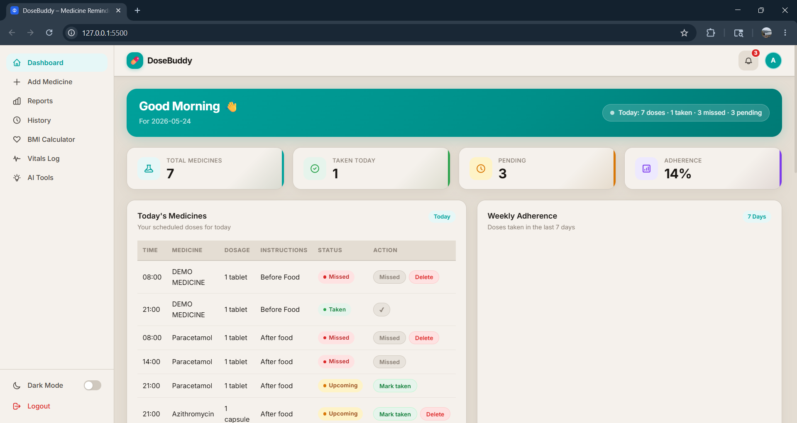
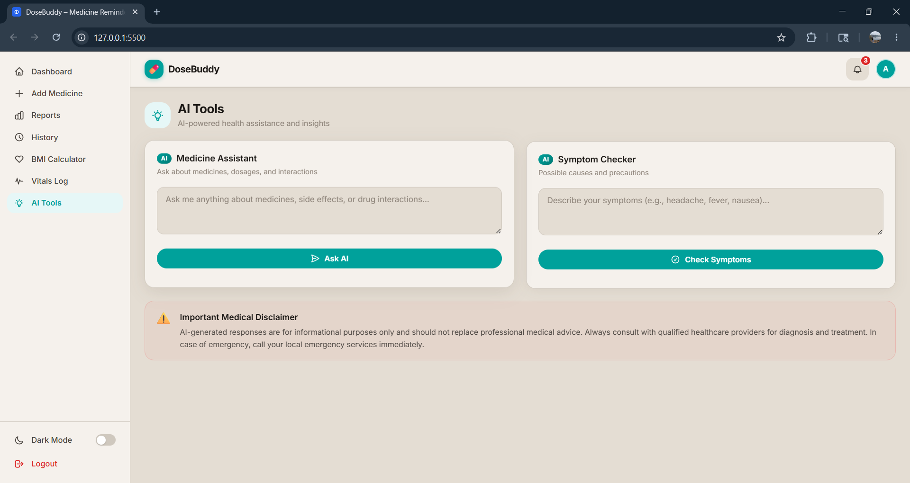
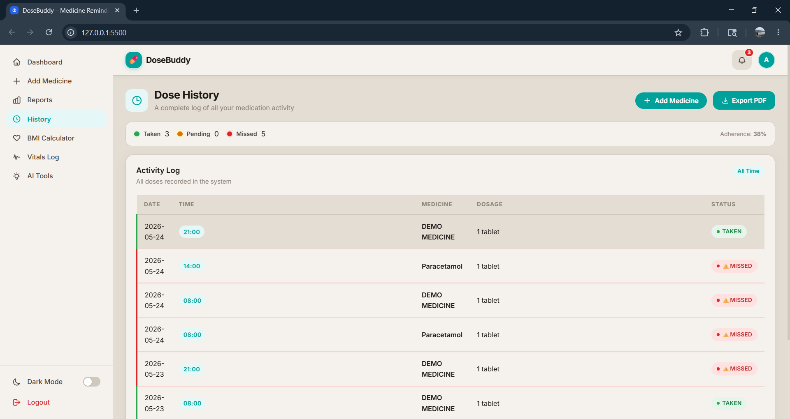
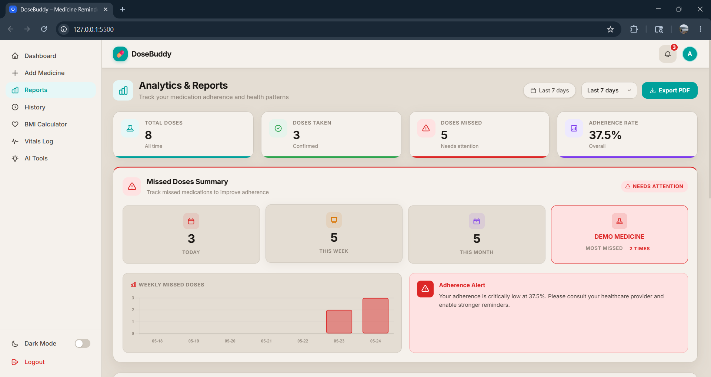

 

# 💊 DoseBuddy

### Medicine Reminders, Health Tracking & AI Assistance

  
  
  
  

  
  
  
  

 

**DoseBuddy** is a full-stack healthcare web application for medication schedules, dose tracking, adherence insights, prescription extraction, and AI-assisted health guidance.

 

---

## About the Project

DoseBuddy helps people maintain medication routines while keeping each dose traceable. The current application uses a static browser client, a Cloudflare Worker API, Hyperdrive-backed MySQL, and a scheduled Worker reconciliation job for dose occurrences.

### What DoseBuddy Provides

| Challenge | DoseBuddy's Solution |
|---|---|
| Forgetting a scheduled dose | User-local schedules, foreground reminders, and eligible Web Push delivery |
| Tracking whether a dose was taken | Authoritative dose occurrences and intake history |
| Time-zone and DST errors | IANA time-zone storage and server-side occurrence resolution |
| Duplicate reminder delivery | Stable event identities, delivery claims, and a retry ledger |
| Prescription data entry | Gemini Vision OCR and structured medicine extraction |
| Health questions and trends | Unified AI assistant, vitals, BMI, adherence, and reports |

> **Reminder delivery:** browser notifications require permission, a valid Push subscription, configured VAPID credentials, and supported device settings. Provider acceptance does not prove that a device displayed or played a notification.

---

## Key Highlights

| 🔐 JWT Auth | 💊 Dose Ledger | 🔔 Web Push | 🌍 Time Zones |
|:---:|:---:|:---:|:---:|
| Access and refresh tokens | Pending, taken, and missed states | Service Worker notification rendering | IANA zones and DST-aware scheduling |

| 🤖 AI Assistant | 📄 Prescription OCR | 📊 Health Analytics | 🌗 Themes |
|:---:|:---:|:---:|:---:|
| Health and medicine guidance | Extract medicine details from uploads | Adherence, history, BMI, and vitals | Responsive light and dark modes |

---

## Features

<b> Medication & Adherence</b>

 

- **Medication Management** — Create, update, and delete medications with multiple daily times
- **Dose Occurrences** — Stable per-dose identities for pending, taken, and missed transitions
- **Mark as Taken** — Authorized, idempotent intake updates with legacy-schema compatibility
- **Missed-dose Reconciliation** — Scheduled Worker processing with a one-minute grace boundary
- **Adherence Insights** — History, trends, streaks, and dashboard summaries

<b> Notifications</b>

 

- **Foreground Alerts** — Browser notifications and optional sound when a page is active and browser policy permits
- **Background Web Push** — Service Worker push handling and notification-click navigation
- **Subscription Lifecycle** — VAPID public-key retrieval, authenticated subscribe/unsubscribe, expiration handling, and diagnostics
- **Duplicate Prevention** — Stable notification event IDs and delivery-attempt claim records
- **Time-zone-aware Scheduling** — User-local time, date boundaries, and daylight-saving transitions handled server-side

<b> AI & Health Features</b>

 

- **Unified AI Assistant** — Conversational medicine, symptom, and health guidance
- **Prescription OCR** — Image and document extraction for medication details
- **Vitals & BMI** — Record and review health measurements
- **Caregiver Access** — Authorized patient/caregiver views where configured

---

## Tech Stack

### Current Runtime

| Technology | Role |
|---|---|
| Cloudflare Workers | TypeScript API and scheduled reconciliation |
| Cloudflare Hyperdrive | Managed connection path to MySQL |
| MySQL 8 | Users, medications, intake ledger, occurrences, subscriptions, and delivery attempts |
| Cloudflare Workers Static Assets | Frontend hosting |
| Vanilla JavaScript | SPA rendering, authenticated API client, Service Worker registration |
| Service Worker + Push API | Background notification display on supported browsers |
| VAPID | Web Push application-server authentication |

### Supporting Services

| Provider | Purpose |
|---|---|
| Groq | Optional AI-assisted medicine and health guidance |
| Google Gemini | Optional prescription-image extraction |
| Legacy Spring Boot project | Retained under DoseBuddy_Backend; the Cloudflare Worker is the current API runtime |

---

## System Architecture

~~~
┌──────────────────────────────────────────────────────────────────┐
│                           USER BROWSER                            │
│  Static SPA · Service Worker · Push Subscription · Optional Audio │
└──────────────────────────────┬───────────────────────────────────┘
                               │ HTTPS / JSON
                               ▼
┌──────────────────────────────────────────────────────────────────┐
│                     CLOUDFLARE WORKERS                           │
│ Auth · Medication API · Intake API · AI routes · Scheduled Cron  │
└───────────────────────┬───────────────────────────────┬──────────┘
                        │ Hyperdrive                     │ Web Push
                        ▼                                ▼
┌───────────────────────────────┐          ┌────────────────────────┐
│            MYSQL              │          │   Browser Push Service  │
│ users · medications · times   │          │ Service Worker displays │
│ dose_occurrences · logs       │          │ system notification     │
│ subscriptions · delivery log  │          └────────────────────────┘
└───────────────────────────────┘
~~~

### Reminder Lifecycle

1. A medication schedule is stored with the user's IANA time zone.
2. The scheduled Worker reconciles due occurrences and writes authoritative state.
3. After a committed reminder or missed-dose transition, eligible subscriptions are claimed.
4. The Worker records each delivery attempt and sends a VAPID-signed Web Push request.
5. When the browser receives the push, the Service Worker displays a system notification.

The server can verify a state transition and provider response. Browser receipt and operating-system display remain device-dependent.

---

## Screenshots

### Dashboard

### Add Medicines

### 🤖 Unified AI Assistant

### BMI Calculator

### Medication History

### Reports & Analytics

### Vitals Log

---

## Project Structure

~~~
DoseBuddy/
├── cloudflare-worker/              # Current TypeScript Worker API
│   ├── index.ts                    # Routes, auth, Cron entry point
│   ├── scheduling.ts               # IANA zone and DST occurrence resolution
│   ├── dose-occurrences.ts         # Authoritative dose-state transitions
│   ├── notification-delivery.ts    # Delivery claim and retry ledger
│   └── web-push.ts                 # VAPID Web Push requests
├── DoseBuddy_frontend/             # Static SPA and Service Worker
│   ├── app.js                      # UI, API client, foreground reminders
│   ├── sw.js                       # Background push and notification clicks
│   ├── index.html                  # Application shell
│   └── wrangler.jsonc              # Static asset Worker configuration
├── DoseBuddy_Backend/              # Legacy Spring Boot implementation
├── tests/                          # Unit, Worker-runtime, and MySQL integration tests
├── database-migrations.sql         # Canonical additive MySQL migration
├── wrangler.jsonc                  # API Worker and Cron configuration
└── README.md
~~~

---

## API Overview

### Authentication

| Method | Endpoint | Description |
|---|---|---|
| POST | /api/auth/signup | Create an account |
| POST | /api/auth/login | Sign in and receive tokens |
| POST | /api/auth/refresh | Refresh an access token |

### Medication & Intake

| Method | Endpoint | Description |
|---|---|---|
| POST | /api/medications/add | Add medication and schedule |
| GET | /api/medications/today/{userId} | Get today's medicines |
| POST | /api/logs/mark | Mark an authorized dose taken or missed |
| POST | /api/logs/mark-missed-batch | Reconcile eligible missed doses |
| GET | /api/logs/today/{userId} | Read today's intake state |

### Time Zone & Push

| Method | Endpoint | Description |
|---|---|---|
| GET / PUT | /api/user/time-zone | Read or save the user's IANA time zone |
| GET | /api/push/vapid-key | Get the public VAPID key |
| POST | /api/push/subscribe | Save a browser Push subscription |
| POST | /api/push/unsubscribe | Disable a saved subscription |
| POST | /api/push/test | Send a controlled test push to the authenticated user |

---

## Installation & Setup

### Prerequisites

| Tool | Version |
|---|---|
| Node.js | Current LTS recommended |
| npm | Bundled with Node.js |
| MySQL | 8.0+ |
| Wrangler | Installed through project dependencies |
| Browser | Current Chrome, Edge, Firefox, or another Push-capable browser |

### Step 1 — Install dependencies

~~~
git clone https://github.com/SUDHEER-KANDURU/DoseBuddy.git
cd DoseBuddy
npm install
~~~

### Step 2 — Configure local secrets

Keep secrets outside Git. The API Worker expects these secret names:

| Secret | Required | Purpose |
|---|---:|---|
| JWT_SECRET | Yes | Signs access and refresh tokens |
| VAPID_PUBLIC_KEY | For Web Push | Browser subscription public key |
| VAPID_PRIVATE_KEY | For Web Push | Server-side VAPID signing key |
| VAPID_EMAIL | For Web Push | VAPID contact subject |
| GROQ_API_KEY | Optional | AI assistant |
| GEMINI_API_KEY | Optional | Prescription OCR |

Never place private keys, connection strings, or API keys in frontend files, source control, or screenshots.

### Step 3 — Prepare a local database

Use a dedicated disposable MySQL schema for local integration testing. Apply [database-migrations.sql](database-migrations.sql) only after reviewing it and confirming the target database.

The migration adds scheduling, occurrence, Push-subscription, and delivery-attempt schema support. It is additive but should be tested against a backup or disposable restore before any production use.

### Step 4 — Run checks

~~~
npm run test:unit
npm run build
npm run test:workerd
npx wrangler deploy --dry-run
~~~

MySQL integration tests require a loopback-only disposable database URL supplied at runtime:

~~~
npm run test:integration
~~~

### Step 5 — Run locally

~~~
npx wrangler dev
~~~

The Worker requires a valid local database connection setup compatible with the configured Hyperdrive/MySQL access path. Do not point local test commands at a production database.

---

## Deployment

The repository contains two Cloudflare Worker configurations:

| Component | Configuration | Purpose |
|---|---|---|
| API Worker | [wrangler.jsonc](wrangler.jsonc) | API, Cron reconciliation, Hyperdrive binding |
| Frontend | [DoseBuddy_frontend/wrangler.jsonc](DoseBuddy_frontend/wrangler.jsonc) | Static application assets and Service Worker |

Before deploying:

1. Run the validation commands above.
2. Confirm the intended Worker name and environment.
3. Confirm Hyperdrive points to the intended MySQL database.
4. Apply the reviewed schema migration through an approved database workflow.
5. Configure Worker secrets using Cloudflare secrets management.
6. Verify login, medication creation, timezone persistence, and a controlled push test.

Do not treat a successful API response or a Web Push provider acceptance as proof of on-device notification display.

---

## Testing

The test suite covers:

- JWT-protected Worker routes and authorization
- Medication creation, deletion, and intake transitions
- Time-zone validation, UTC boundaries, and DST scheduling
- Dose occurrence concurrency and duplicate prevention
- Push subscription, delivery claims, expiry, retries, and Service Worker payload handling
- Migration convergence and local MySQL rollback recovery
- AI-assistant and frontend regression behavior

Run all non-MySQL checks with:

~~~
npm run verify
~~~

---

## Future Scope

- [ ] Installed-PWA and mobile notification experience validation
- [ ] Native mobile clients for platform-specific sound and delivery guarantees
- [ ] Caregiver escalation workflows
- [ ] Expanded medication-interaction review
- [ ] Multi-language accessibility support

---

## Author

 

**Sudheer Kanduru**

*Full-Stack Developer · B.Tech CSE (AI & ML) · SRMIST*

 

 

